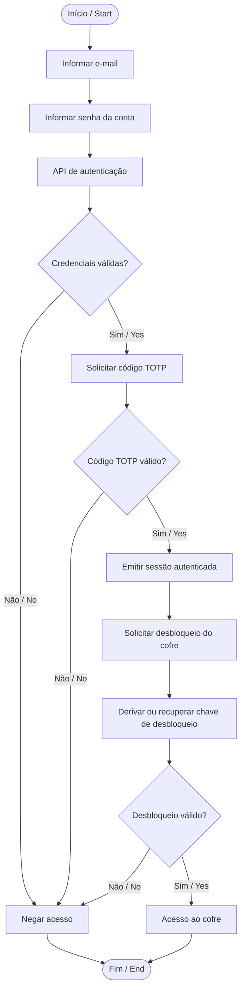

# AM-DIA-005 — Diagrama de Fluxo de Autenticação
# AM-DIA-005 — Authentication Flow Diagram

**Projeto / Project:** Access Manager
**Versão / Version:** 1.0
**Status / Status:** Proposta inicial / Initial proposal
**Data / Date:** 19/11/2026

## 1. Objetivo / Purpose

**Português**

Documentar o fluxo planejado de autenticação dos usuários, contemplando identificação por e-mail, validação da senha da conta, autenticação multifator e desbloqueio do cofre.

**English**

Document the planned user authentication flow, including email identification, account password validation, multifactor authentication, and vault unlocking.

## 2. Diagrama / Diagram

## 3. Etapas de autenticação / Authentication stages

1. O usuário informa seu e-mail cadastrado.
2. O usuário informa a senha da conta.
3. A API valida as credenciais.
4. Se as credenciais forem válidas, o sistema solicita o código TOTP.
5. A API valida o segundo fator.
6. Após a validação, o sistema estabelece uma sessão autenticada.
7. O usuário solicita o desbloqueio do cofre.
8. O mecanismo criptográfico do cliente obtém ou deriva a chave necessária.
9. O cofre é desbloqueado somente se a validação criptográfica for bem-sucedida.

## 4. Requisitos de segurança / Security requirements

- A senha da conta não deve ser armazenada em texto puro.
- A senha da conta e a chave de desbloqueio do cofre devem possuir finalidades distintas.
- O segredo TOTP deve ser protegido em armazenamento.
- Os códigos TOTP devem ser validados no servidor.
- A sessão deve possuir prazo de validade e mecanismos de revogação.
- Devem existir controles contra tentativas repetidas de autenticação.
- A recuperação de conta e de acesso ao cofre deve ser documentada separadamente.
- O fluxo não deve expor chaves privadas ou segredos criptográficos nos logs.

## 5. Observações e pendências / Notes and open points

**Português**

Este fluxo representa a proposta inicial de autenticação com segundo fator TOTP.

Ainda será necessário especificar:

- Cadastro e ativação do segundo fator.
- Recuperação em caso de perda do dispositivo autenticador.
- Expiração, renovação e revogação de sessões.
- Política de bloqueio e limitação de tentativas.
- Derivação e recuperação da chave de desbloqueio.
- Procedimentos de recuperação de conta sem comprometer a criptografia do cofre.

A autenticação bem-sucedida não deve conceder automaticamente acesso criptográfico ao conteúdo do cofre.

**English**

This flow represents the initial proposal for authentication using TOTP as a second factor.

The following still need specification:

- Second-factor enrollment and activation.
- Recovery in case of authenticator device loss.
- Session expiration, renewal, and revocation.
- Account lockout and attempt-limiting policies.
- Vault unlocking key derivation and recovery.
- Account recovery procedures that do not compromise vault encryption.

Successful authentication must not automatically grant cryptographic access to vault contents.

## 6. Controle documental / Document control

- Identificador / Identifier: AM-DIA-005
- Categoria / Category: Segurança / Security
- Tipo / Type: Diagrama de autenticação / Authentication flow diagram
- Versão / Version: 1.0