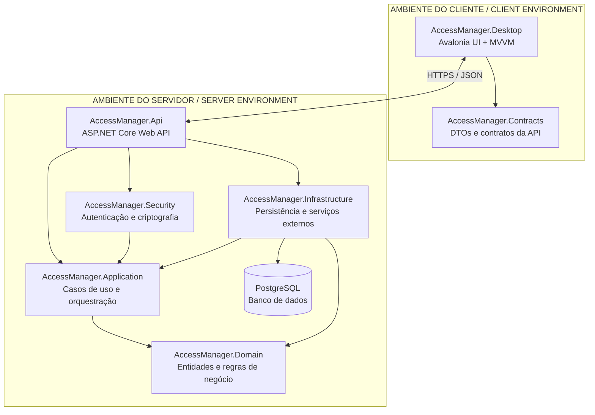

# AM-DIA-002 — Diagrama de Arquitetura de Contêineres
# AM-DIA-002 — Container Architecture Diagram

**Projeto / Project:** Access Manager
**Versão / Version:** 1.0
**Status / Status:** Proposta inicial / Initial proposal
**Data / Date:** 19/11/2026

---

## 1. Objetivo / Purpose

**Português**

Este documento apresenta a estrutura interna planejada do Access Manager, identificando os principais componentes executáveis e módulos lógicos, suas responsabilidades e os mecanismos de comunicação entre eles.

O diagrama utiliza o conceito de contêineres da abordagem C4. Nesse contexto, contêiner representa uma unidade executável ou um armazenamento de dados, não necessariamente um contêiner Docker.

**English**

This document presents the planned internal structure of Access Manager, identifying its main executable components and logical modules, their responsibilities, and communication mechanisms.

The diagram follows the C4 container concept. In this context, a container represents an executable unit or data store, not necessarily a Docker container.

## 2. Diagrama / Diagram

## 3. Responsabilidades / Responsibilities

| Projeto / Project | Responsabilidade / Responsibility |
|---|---|
| AccessManager.Desktop | Interface gráfica e interação com o usuário. / User interface and interaction. |
| AccessManager.Contracts | Contratos de comunicação entre cliente e API. / Client and API communication contracts. |
| AccessManager.Api | Endpoints HTTP, configuração e composição da aplicação. / HTTP endpoints, configuration, and application composition. |
| AccessManager.Application | Casos de uso e coordenação das operações. / Use cases and operation orchestration. |
| AccessManager.Domain | Entidades, regras e conceitos centrais do negócio. / Core entities, rules, and business concepts. |
| AccessManager.Security | Implementações de mecanismos de autenticação e criptografia. / Authentication and encryption mechanisms. |
| AccessManager.Infrastructure | Persistência, acesso ao banco e integrações externas. / Persistence, database access, and external integrations. |
| PostgreSQL | Armazenamento persistente dos dados. / Persistent data storage. |

## 4. Comunicação entre componentes / Component communication

1. O Desktop envia solicitações à API por HTTPS.
2. Os contratos definem os formatos de requisição e resposta.
3. A API encaminha as solicitações aos casos de uso da camada Application.
4. As regras centrais de negócio são representadas na camada Domain.
5. A camada Security fornece implementações de mecanismos de segurança.
6. A camada Infrastructure implementa persistência e integrações.
7. O PostgreSQL é acessado exclusivamente pelo backend.

## 5. Diretrizes arquiteturais / Architectural guidelines

- O cliente não deve acessar diretamente o banco de dados.
- A API é o ponto de entrada para operações remotas.
- As regras de negócio não devem ficar concentradas nos controladores HTTP.
- A infraestrutura deve ser substituível sem comprometer as regras centrais do domínio.
- A criptografia de credenciais deve ser projetada para impedir que o backend leia o conteúdo em texto puro.
- A direção das dependências entre projetos deve respeitar a matriz definida em AM-ARC-002.

## 6. Observações e pendências / Notes and open points

**Português**

Este diagrama representa a organização lógica planejada. Antes de implementar integrações, a direção das dependências entre Security, Application e Infrastructure deverá ser revisada e validada.

A representação também não significa que todos os componentes já estejam implementados ou integrados.

**English**

This diagram represents the planned logical organization. Before implementing integrations, dependency directions between Security, Application, and Infrastructure must be reviewed and validated.

The diagram does not imply that all components have already been implemented or integrated.

---

**Controle documental / Document control**

- Identificador / Identifier: AM-DIA-002
- Categoria / Category: Arquitetura / Architecture
- Tipo / Type: Diagrama de contêineres / Container diagram
- Versão / Version: 1.0