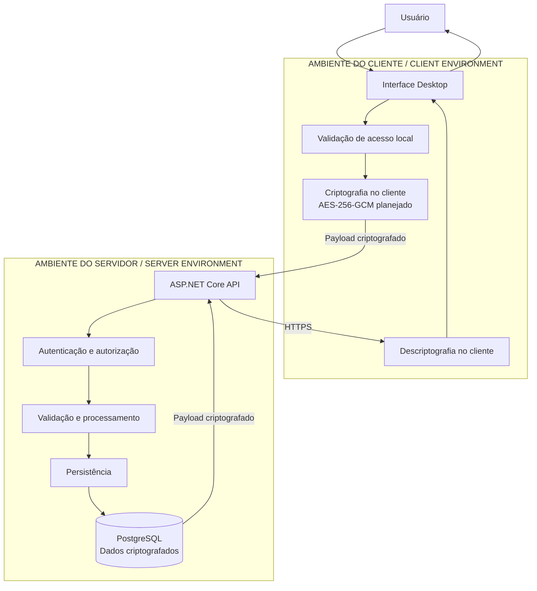

# AM-DIA-004 — Diagrama de Fluxo de Dados
# AM-DIA-004 — Data Flow Diagram

**Projeto / Project:** Access Manager
**Versão / Version:** 1.0
**Status / Status:** Proposta inicial / Initial proposal
**Data / Date:** 19/11/2026

## 1. Objetivo / Purpose

**Português**

Documentar o fluxo planejado dos dados entre a aplicação Desktop, a API e o banco de dados, destacando os limites de segurança e o tratamento das credenciais sensíveis.

**English**

Document the planned data flow between the Desktop application, API, and database, highlighting security boundaries and the handling of sensitive credentials.

## 2. Diagrama / Diagram

## 3. Etapas do fluxo / Flow stages

1. O usuário informa os dados na aplicação Desktop.
2. O cliente verifica se o usuário possui autorização para executar a operação.
3. O conteúdo sensível é criptografado no cliente.
4. O payload criptografado é transmitido à API por HTTPS.
5. A API valida a identidade e as permissões da solicitação.
6. A infraestrutura persiste o conteúdo criptografado no PostgreSQL.
7. Quando autorizado, o cliente recebe o conteúdo criptografado.
8. A descriptografia ocorre no ambiente do cliente.

## 4. Diretrizes de segurança / Security guidelines

- O servidor não deve receber credenciais em texto puro.
- O banco de dados deve armazenar os payloads sensíveis criptografados.
- HTTPS deve proteger a comunicação em trânsito.
- A criptografia deve utilizar nonce único por chave e autenticação de integridade.
- A implementação deverá contemplar versionamento do formato criptográfico.
- O cliente poderá manter dados descriptografados temporariamente em memória enquanto o cofre estiver desbloqueado.
- Logs não devem registrar senhas, chaves privadas, tokens ou conteúdo sensível.

## 5. Observações técnicas / Technical notes

**Português**

O uso de AES-256-GCM e criptografia de envelope representa uma direção arquitetural planejada, ainda sujeita à especificação detalhada, revisão de segurança e testes.

A autenticação da conta e a chave utilizada para desbloquear o cofre deverão possuir funções distintas.

O servidor poderá processar metadados necessários à operação, mas não deverá possuir acesso às credenciais em texto puro.

**English**

The use of AES-256-GCM and envelope encryption represents a planned architectural direction, still subject to detailed specification, security review, and testing.

Account authentication and the key used to unlock the vault must have distinct purposes.

The server may process metadata required for operations but must not have access to plaintext credentials.

## 6. Controle documental / Document control

- Identificador / Identifier: AM-DIA-004
- Categoria / Category: Arquitetura e Segurança / Architecture and Security
- Tipo / Type: Diagrama de fluxo de dados / Data flow diagram
- Versão / Version: 1.0