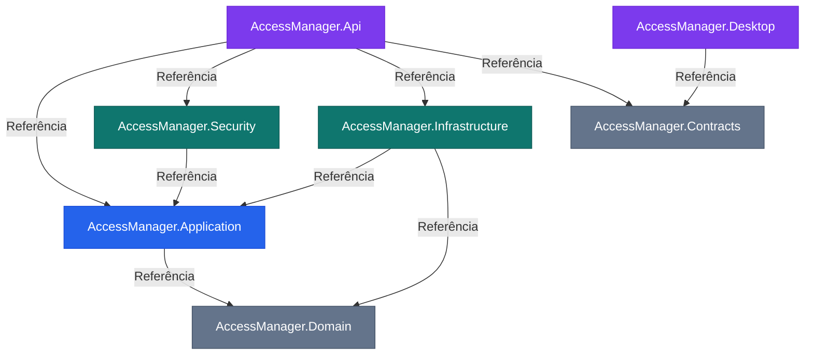

# AM-DIA-003 — Diagrama de Dependências entre Projetos
# AM-DIA-003 — Project Dependency Diagram

**Projeto / Project:** Access Manager
**Versão / Version:** 1.0
**Status / Status:** Proposta para validação / Proposal for validation
**Data / Date:** 19/11/2026

---

## 1. Objetivo / Purpose

**Português**

Representar visualmente as dependências permitidas entre os sete projetos da solução Access Manager, garantindo organização, separação de responsabilidades e redução do acoplamento.

**English**

Visually represent the allowed dependencies between the seven projects in the Access Manager solution, ensuring organization, separation of responsibilities, and reduced coupling.

## 2. Diagrama / Diagram

**Interpretação das setas / Arrow interpretation:** a seta parte do projeto que possui a referência e aponta para o projeto referenciado.

## 3. Matriz de dependências / Dependency matrix

| Projeto / Project | Dependências permitidas / Allowed dependencies |
|---|---|
| Domain | Nenhuma / None |
| Application | Domain |
| Security | Application |
| Infrastructure | Application, Domain |
| Contracts | Nenhuma / None |
| API | Application, Security, Infrastructure, Contracts |
| Desktop | Contracts |

## 4. Regras arquiteturais / Architectural rules

1. Domain não deve depender de outros projetos da solução.
2. Application pode depender de Domain.
3. Security deve implementar os mecanismos de segurança conforme os contratos definidos pela arquitetura.
4. Infrastructure deve implementar recursos técnicos e persistência.
5. Contracts deve permanecer independente das camadas internas.
6. Desktop deve consumir os contratos de comunicação, sem referenciar diretamente Infrastructure ou Domain.
7. API é responsável pela composição dos componentes e pela exposição dos serviços.

## 5. Ponto de revisão arquitetural / Architectural review point

**Português**

A dependência Security → Application será mantida como proposta nesta versão, mas precisa ser analisada antes de ser considerada definitiva.

Devemos verificar se as abstrações utilizadas pela camada Security realmente pertencem à Application ou se algumas delas deveriam estar em um projeto independente de abstrações.

A decisão deverá ser registrada em AM-ARC-003, com justificativa técnica.

**English**

The Security → Application dependency is retained as a proposal in this version but must be reviewed before being considered definitive.

We must verify whether the abstractions used by the Security layer actually belong in Application or whether some should be placed in an independent abstractions project.

The decision must be recorded in AM-ARC-003, with technical justification.

## 6. Controle documental / Document control

- Identificador / Identifier: AM-DIA-003
- Categoria / Category: Arquitetura / Architecture
- Tipo / Type: Diagrama de dependências / Dependency diagram
- Versão / Version: 1.0
- Documento relacionado / Related document: AM-ARC-002