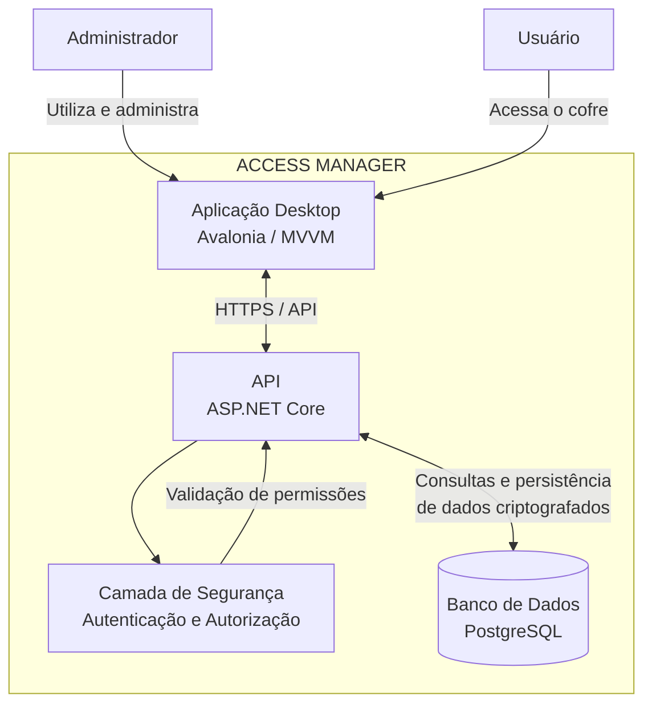

# AM-DIA-001 — Diagrama de Contexto do Sistema
# AM-DIA-001 — System Context Diagram

**Projeto / Project:** Access Manager
**Versão / Version:** 1.0
**Status / Status:** Proposta inicial / Initial proposal
**Data / Date:** 19/11/2026

---

## 1. Objetivo / Purpose

**Português**

Este documento apresenta o contexto geral do Access Manager, identificando os atores, os componentes externos e as principais interações necessárias para a utilização da plataforma.

O diagrama representa a arquitetura planejada, não necessariamente funcionalidades já implementadas.

**English**

This document presents the general context of Access Manager, identifying actors, external components, and the main interactions required to use the platform.

The diagram represents the planned architecture, not necessarily features already implemented.

## 2. Diagrama / Diagram

## 3. Descrição dos componentes / Component description

| Componente | Responsabilidade |
|---|---|
| Administrador / Administrator | Gerenciar usuários e permissões conforme sua função. |
| Usuário / User | Acessar e gerenciar credenciais autorizadas. |
| Aplicação Desktop / Desktop Application | Interface gráfica para interação com a plataforma. |
| API | Receber e processar solicitações dos clientes. |
| Camada de Segurança / Security Layer | Apoiar autenticação e autorização. |
| PostgreSQL | Armazenar os dados persistidos pela plataforma. |

## 4. Regras arquiteturais / Architectural rules

1. A aplicação Desktop deve se comunicar com o backend exclusivamente por meio da API.
2. A comunicação entre Desktop e API deve utilizar HTTPS.
3. O Desktop não deve estabelecer conexão direta com o PostgreSQL.
4. A API deve validar a identidade e as permissões antes de executar operações protegidas.
5. Os dados sensíveis do cofre devem ser armazenados criptografados.
6. A arquitetura de criptografia planejada deve impedir que o servidor tenha acesso ao conteúdo em texto puro das credenciais.

## 5. Limitações e observações / Limitations and notes

**Português**

Este diagrama é uma representação inicial. O fluxo detalhado de autenticação multifator, recuperação de conta, criptografia, compartilhamento de credenciais e revogação de acesso será documentado em diagramas específicos.

**English**

This diagram is an initial representation. Detailed flows for multifactor authentication, account recovery, encryption, credential sharing, and access revocation will be documented in separate diagrams.

---

**Controle documental / Document control**

- Identificador / Identifier: AM-DIA-001
- Categoria / Category: Arquitetura / Architecture
- Tipo / Type: Diagrama de contexto / Context diagram
- Versão / Version: 1.0